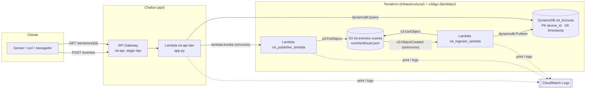
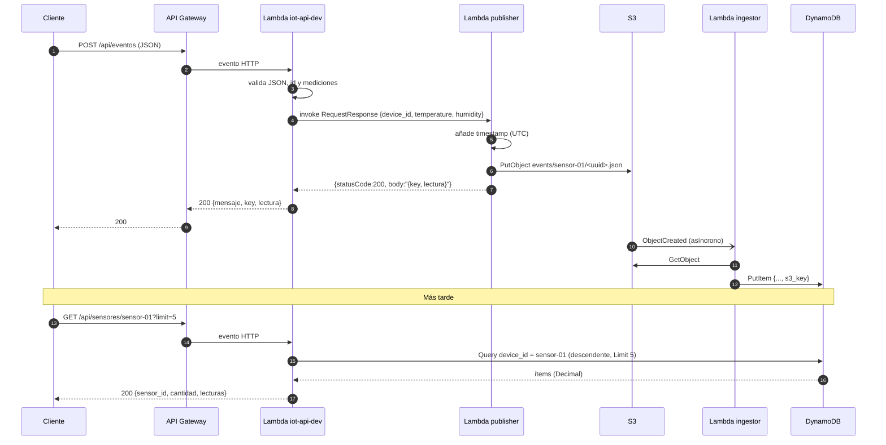

# Cómo funciona todo: código y AWS

Este documento explica **qué hace cada pieza**, **cómo se conectan** y **por qué** se tomó cada decisión. Para ejecutarlo paso a paso, ver [GUIA-PASO-A-PASO.md](GUIA-PASO-A-PASO.md).

## Índice

1. [La idea en una frase](#1-la-idea-en-una-frase)
2. [Mapa general](#2-mapa-general)
3. [Los servicios de AWS que se usan](#3-los-servicios-de-aws-que-se-usan)
4. [Quién crea cada recurso](#4-quién-crea-cada-recurso)
5. [Recorrido completo de un evento](#5-recorrido-completo-de-un-evento)
6. [Infraestructura: `infraestructura/main.tf`](#6-infraestructura-infraestructuramaintf)
7. [Lambda publisher](#7-lambda-publisher-lambdassrcpublisherlambda_functionpy)
8. [Lambda ingestor](#8-lambda-ingestor-lambdassrcingestorlambda_functionpy)
9. [API REST con Chalice](#9-api-rest-con-chalice-api)
10. [Herramientas: Docker, Makefile y scripts](#10-herramientas-docker-makefile-y-scripts)
11. [Pruebas locales](#11-pruebas-locales)
12. [Restricciones del Learner Lab](#12-restricciones-del-learner-lab)
13. [Límites y comportamientos a tener en cuenta](#13-límites-y-comportamientos-a-tener-en-cuenta)
14. [Glosario](#14-glosario)

---

## 1. La idea en una frase

Un sensor envía su lectura a una **API REST**; la API se la pasa a una **lambda publicadora** que la guarda como archivo JSON en **S3**; S3 avisa automáticamente a una **lambda ingestora**, que lee ese archivo y lo inserta en **DynamoDB**; la misma API permite **consultar** las lecturas de cada sensor.

## 2. Mapa general



Hay **dos caminos**:

| Camino | Qué pasa | ¿Síncrono? |
|---|---|---|
| **Escritura** (`POST /eventos`) | API → publisher → S3 → ingestor → DynamoDB | Hasta S3 sí (el cliente recibe la key del archivo); de S3 a DynamoDB **no** (ocurre en segundo plano, ~1 s después). |
| **Lectura** (`GET /sensores/{id}`) | API → DynamoDB | Sí. |

---

## 3. Los servicios de AWS que se usan

### AWS Lambda
Ejecuta funciones (código Python) **sin servidores**: AWS levanta un contenedor cuando llega un evento, llama a la función `lambda_handler(event, context)` y cobra por milisegundo. Aquí hay **tres** lambdas:

| Lambda | La crea | La invoca | Hace |
|---|---|---|---|
| `iot_publisher_lambda` | Terraform | La API (o `make invoke`) | Escribe el JSON en S3 |
| `iot_ingestor_lambda` | Terraform | S3 (evento `ObjectCreated`) | Lee el JSON y lo guarda en DynamoDB |
| `iot-api-dev` | Chalice | API Gateway | Atiende las rutas HTTP de `app.py` |

Cada lambda recibe sus parámetros por **variables de entorno** (`BUCKET_NAME`, `TABLE_NAME`, `PUBLISHER_FUNCTION`), así el código no tiene nombres "quemados".

**Dos formas de invocar una lambda** (importante para entender el flujo):
- **Síncrona (`RequestResponse`)**: quien llama espera la respuesta. Así llama la API a la publisher, para poder devolver la `key` al cliente o un error.
- **Asíncrona (`Event`)**: AWS encola el evento y responde enseguida; si la función falla, AWS reintenta (hasta 2 veces). Así invoca **S3** a la ingestor.

### Amazon S3
Almacenamiento de objetos (archivos). El bucket `iot-eventos-<id de cuenta>` (el id hace el nombre único en el mundo) guarda cada lectura como `events/<device_id>/<uuid>.json`. Además de almacenar, S3 hace de **disparador**: tiene una **notificación de eventos** que, cada vez que se crea un objeto que empieza por `events/` y termina en `.json`, invoca a la ingestor.

¿Por qué pasar por S3 y no escribir directo en DynamoDB? Es el diseño del ejercicio: S3 actúa como **registro crudo** (se conserva el JSON original de cada evento) y **desacopla** a quien produce los datos de quien los procesa.

### Amazon DynamoDB
Base de datos NoSQL clave-valor. La tabla `iot_lecturas`:

| Atributo | Rol | Tipo |
|---|---|---|
| `device_id` | **Clave de partición** (agrupa todas las lecturas de un sensor) | String |
| `timestamp` | **Clave de ordenamiento** (ordena las lecturas de un sensor por fecha) | String ISO 8601 |
| cualquier otro (`temperature`, `tipo`, `valor`, `s3_key`...) | Atributos libres: cada ítem puede tener campos distintos | — |

- **`Query`** (lo que usa el GET) busca por clave de partición: lee **solo** las lecturas de ese sensor, ya ordenadas por `timestamp`. Es eficiente.
- **`Scan`** (lo que usa `make scan`) recorre **toda** la tabla. Sirve para revisar, no para la API.
- Modo **`PAY_PER_REQUEST`**: no hay capacidad que configurar; se paga por petición.
- Los números se guardan como **`Decimal`** (DynamoDB no acepta `float` de Python); por eso hay conversiones en el código.
- Como el timestamp ISO es texto con formato fijo, ordenarlo alfabéticamente = ordenarlo cronológicamente.

### Amazon API Gateway
Expone una **URL HTTPS pública** y traduce cada petición HTTP en una invocación a la lambda `iot-api-dev`. Chalice lo crea como **REST API** llamada `iot-api` con el stage `api` (por eso la URL termina en `/api/`). Si se pide una ruta o un método que no está definido, API Gateway responde **403 `Missing Authentication Token`** sin llegar a la lambda.

### IAM (permisos)
Cada lambda se ejecuta con un **rol IAM** que define qué puede hacer. En el Learner Lab **no se pueden crear roles**, así que las tres usan el rol existente **`LabRole`**, que ya tiene permisos sobre S3, DynamoDB, Lambda y CloudWatch. Además, S3 necesita **permiso para invocar** a la ingestor (`aws_lambda_permission`) y API Gateway para invocar a `iot-api-dev` (lo añade Chalice).

### CloudWatch Logs
Todo lo que el código imprime con `print(...)` o `app.log` queda en un grupo de logs por lambda: `/aws/lambda/iot_publisher_lambda`, `/aws/lambda/iot_ingestor_lambda`, `/aws/lambda/iot-api-dev`. Se consultan con `aws logs tail <grupo> --since 15m`.

---

## 4. Quién crea cada recurso

El proyecto simula **tres repositorios independientes**, cada uno dueño de lo suyo:

| Carpeta | Herramienta | Crea / gestiona | Comandos |
|---|---|---|---|
| `infraestructura/` | **Terraform** | Bucket S3, tabla DynamoDB, las lambdas publisher e ingestor (con código vacío), permiso + notificación S3 → ingestor | `make infra-apply` / `make infra-destroy` |
| `lambdas/` | **AWS CLI** (`deploy.sh`) | Solo el **código** de publisher e ingestor (`update-function-code`) | `make deploy` |
| `api/` | **Chalice** | Lambda `iot-api-dev`, API Gateway `iot-api`, permiso API Gateway → lambda | `make api-deploy` / `make api-delete` |

**Chalice no se integra con Terraform**: Terraform no sabe que la API existe y Chalice no toca nada de Terraform. Por eso el orden para borrar es **primero la API, después la infraestructura** (la API depende de la publisher y de la tabla).

Cada herramienta guarda su propio **estado** en disco para saber qué creó:
- Terraform: `infraestructura/terraform.tfstate`.
- Chalice: `api/.chalice/deployed/dev.json`.

Si se borran esos archivos con recursos vivos en AWS, las herramientas "olvidan" lo que crearon y habría que borrarlos a mano.

---

## 5. Recorrido completo de un evento

Ejemplo: `POST /eventos` con `{"device_id":"sensor-01","temperature":23.5,"humidity":60}`.



Cómo se ve el dato en cada etapa:

**1. Body que envía el cliente**
```json
{"device_id": "sensor-01", "temperature": 23.5, "humidity": 60}
```

**2. Payload con el que la API invoca a la publisher** (id normalizado a `device_id`)
```json
{"temperature": 23.5, "humidity": 60, "device_id": "sensor-01"}
```

**3. Archivo en S3** `events/sensor-01/8f1c...json` (la publisher añadió `timestamp`)
```json
{"device_id": "sensor-01", "timestamp": "2026-11-25T19:21:50.329216+00:00", "temperature": 23.5, "humidity": 60}
```

**4. Respuesta de la publisher a la API** (`body` es un texto JSON, formato típico de Lambda)
```json
{"statusCode": 200, "body": "{\"key\": \"events/sensor-01/8f1c...json\", \"lectura\": {...}}"}
```

**5. Respuesta de la API al cliente** (la API desempaqueta el `body`)
```json
{"mensaje": "evento publicado", "key": "events/sensor-01/8f1c...json", "lectura": {...}}
```

**6. Evento que S3 envía a la ingestor** (resumido)
```json
{"Records": [{"s3": {"bucket": {"name": "iot-eventos-123456789012"},
                     "object": {"key": "events/sensor-01/8f1c...json"}}}]}
```

**7. Ítem en DynamoDB** (la ingestor añadió `s3_key`, para rastrear el archivo de origen)
```json
{"device_id": "sensor-01", "timestamp": "2026-11-25T19:21:50.329216+00:00",
 "temperature": 23.5, "humidity": 60, "s3_key": "events/sensor-01/8f1c...json"}
```

**8. Respuesta del GET**
```json
{"sensor_id": "sensor-01", "cantidad": 1, "lecturas": [{...el ítem anterior...}]}
```

---

## 6. Infraestructura: `infraestructura/main.tf`

Terraform describe la infraestructura como código: `terraform plan` calcula qué cambiar y `terraform apply` lo crea. Recurso por recurso:

| # | Bloque | Qué hace y por qué |
|---|---|---|
| — | `provider "aws"` | Región `us-east-1` (la del Learner Lab). |
| — | `data "aws_iam_role" "lab_role"` | **Lee** el rol `LabRole` existente (no lo crea; en el lab está prohibido). |
| — | `data "aws_caller_identity"` | Obtiene el id de la cuenta para nombrar el bucket. |
| 1 | `terraform_data "bucket_eventos"` | Crea el bucket con la **AWS CLI** (`local-exec`) en vez del recurso `aws_s3_bucket`. Motivo: ese recurso siempre consulta la configuración *Object Lock* del bucket, y una política (SCP) del Learner Lab lo prohíbe, haciendo fallar el `plan`. Con `terraform_data` Terraform sigue controlando el ciclo de vida (crea en `apply`, borra con `--force` en `destroy`) sin leer esas configuraciones. |
| 2 | `aws_dynamodb_table "lecturas"` | Tabla `iot_lecturas`, `PAY_PER_REQUEST`, claves `device_id` (HASH) y `timestamp` (RANGE). Solo se declaran los atributos clave; el resto es libre. |
| 3 | `data "archive_file" "dummy_zip"` | Terraform exige un zip para crear una lambda: se genera uno mínimo con un handler vacío. |
| 4 | `aws_lambda_function "publicadora"` | `iot_publisher_lambda`, Python 3.12, timeout 10 s, variable `BUCKET_NAME`. |
| 5 | `aws_lambda_function "ingestora"` | `iot_ingestor_lambda`, Python 3.12, timeout 10 s, variable `TABLE_NAME`. |
| — | `lifecycle { ignore_changes = [filename, source_code_hash] }` | El código real lo sube `deploy.sh`; esto evita que un `terraform apply` posterior lo **pise** con el zip vacío. |
| 6a | `aws_lambda_permission "permitir_s3"` | Autoriza al servicio `s3.amazonaws.com` (solo desde este bucket) a invocar la ingestor. |
| 6b | `aws_s3_bucket_notification` | Configura el disparador: `s3:ObjectCreated:*` con prefijo `events/` y sufijo `.json` → ingestor. `depends_on` el permiso, porque AWS rechaza la notificación si S3 aún no puede invocar la lambda. |
| — | `output` | `bucket_name`, `table_name`, nombres de las lambdas. Los usan el Makefile y la guía (`terraform output -raw bucket_name`). |

Total: **6 recursos** (`Apply complete! Resources: 6 added`); los `data` solo leen.

---

## 7. Lambda publisher (`lambdas/src/publisher/lambda_function.py`)

**Responsabilidad:** convertir el evento recibido en una lectura completa y guardarla en S3.

```python
def armar_lectura(event):
    datos = dict(event or {})
    device_id = datos.pop("device_id", None) or datos.pop("sensor_id", None) or "sensor-01"
    datos.pop("sensor_id", None)
    timestamp = datos.pop("timestamp", None) or datetime.now(timezone.utc).isoformat()
    lectura = {"device_id": str(device_id), "timestamp": str(timestamp)}
    if datos:            # vienen mediciones reales -> se guardan tal cual
        lectura.update(datos)
    else:                # solo vino el id -> lectura simulada
        lectura["temperature"] = ...; lectura["humidity"] = ...
    return lectura
```

Reglas:
1. **Id del sensor**: acepta `device_id` o `sensor_id` y siempre lo guarda como `device_id`, porque es la clave de partición de la tabla.
2. **Timestamp**: si no viene, usa la hora actual en **UTC** (ISO 8601). UTC evita problemas de zonas horarias y mantiene el orden correcto.
3. **Mediciones**: cualquier otro campo (`temperature`, `ruido`, `tipo`/`valor`...) se copia **sin modificar**. Así sirve para cualquier tipo de sensor.
4. **Sin mediciones** (solo el id, como hace `make invoke`): genera temperatura y humedad aleatorias. Se conserva el comportamiento del ejemplo original.

Después, `lambda_handler`:
- Arma la key `events/<device_id>/<uuid4>.json`. El **UUID** garantiza que dos eventos nunca se sobrescriban en S3. El prefijo `events/` es justo lo que filtra la notificación.
- Hace `s3.put_object(...)` con `ContentType: application/json`.
- Devuelve `{"statusCode": 200, "body": "<json con key y lectura>"}`.

El cliente `boto3.client("s3")` se crea **fuera** del handler: Lambda reutiliza el contenedor entre invocaciones ("warm start"), así no se recrea en cada llamada.

`main()` permite correrla desde el PC contra el bucket real (`make run-publisher`).

## 8. Lambda ingestor (`lambdas/src/ingestor/lambda_function.py`)

**Responsabilidad:** por cada archivo nuevo en S3, guardarlo como ítem en DynamoDB.

Paso a paso dentro de `lambda_handler(event, context)`:
1. Recorre `event["Records"]`: un evento de S3 puede traer **varios** objetos.
2. **`unquote_plus(key)`**: S3 envía la key codificada como URL (un espacio llega como `+`); hay que decodificarla para poder leer el objeto.
3. `s3.get_object(...)` descarga el JSON.
4. **`json.loads(body, parse_float=Decimal)`**: convierte los decimales directamente a `Decimal`, porque `put_item` rechaza `float`.
5. **Valida** que existan `device_id` y `timestamp` (son las claves de la tabla). Si faltan, registra `Ignorado ...` en el log y sigue con el siguiente registro, en vez de fallar todo el lote.
6. Copia **todos** los campos al ítem (sin exigir `temperature`) y añade `s3_key` para saber de qué archivo vino.
7. `table.put_item(Item=item)` y `print("Insertado ...")` (es lo que se ve en CloudWatch, paso 8.5 de la guía).
8. Devuelve `{"statusCode": 200, "insertados": N}`.

`put_item` **reemplaza** el ítem si ya existe otro con el mismo `device_id` + `timestamp`. Con timestamps generados automáticamente (microsegundos) es prácticamente imposible que coincidan, pero si el cliente envía siempre el mismo `timestamp`, la lectura anterior se sobrescribe.

---

## 9. API REST con Chalice (`api/`)

[Chalice](https://aws.github.io/chalice/) es un framework de AWS que, con decoradores tipo Flask, genera y despliega la **lambda + API Gateway** a partir de un único `app.py`.

```
api/
├── app.py                  # Rutas de la API
├── .chalice/config.json    # Configuración por stage (rol, variables de entorno)
├── .chalice/deployed/      # Estado de Chalice (qué recursos creó)
├── requirements.txt        # Dependencias que se empaquetan (vacío: boto3 ya viene en Lambda)
├── requirements-dev.txt    # Herramientas para probar/desplegar (chalice, moto, pytest)
├── deploy.sh               # Rellena el ARN de LabRole y ejecuta chalice deploy/delete/url
└── tests/test_app.py       # Pruebas locales
```

### 9.1 `app.py` por partes

**Clientes perezosos (lazy)**

```python
_clientes = {}
def lambda_client(): ...   # crea boto3.client("lambda") la primera vez
def tabla(): ...           # crea boto3.resource("dynamodb").Table(TABLE_NAME) la primera vez
```
Se crean al primer uso y se reutilizan. Además, permiten que las pruebas **reemplacen** esos clientes por falsos sin tocar AWS.

**`GET /`**: responde `{"api": "iot-api", "estado": "ok", "endpoints": {...}}`. Sirve para comprobar que la API está viva. Sin esta ruta, la URL base devuelve `Missing Authentication Token`.

**`POST /eventos`** (`content_types=["application/json"]`: cualquier otro `Content-Type` → **415** automático de Chalice). Validaciones en orden; cualquier fallo responde **400** con un mensaje claro y **no** invoca la lambda:

| Validación | Ejemplo rechazado |
|---|---|
| El body es JSON válido | `no es json`, body vacío |
| No se aceptan `NaN`/`Infinity` (`parse_constant`) | `{"temperature": NaN}` (DynamoDB no los admite) |
| Es un objeto `{...}` | `[1, 2]` |
| Si vienen `device_id` y `sensor_id`, coinciden | `{"device_id":"a","sensor_id":"b",...}` |
| Hay id, es texto y cumple `^[A-Za-z0-9_.:-]{1,64}$` | sin id, `""`, `123`, `"a/b"` |
| `timestamp`, si viene, es texto | `"timestamp": 5` |
| Hay al menos una medición | `{"device_id":"s1"}` |

El patrón del id evita `/` y caracteres raros, que romperían la estructura de carpetas en S3 y la ruta `/sensores/{id}`.

Luego invoca a la publisher:
```python
resp = lambda_client().invoke(FunctionName=funcion,
                              InvocationType="RequestResponse",
                              Payload=json.dumps(payload).encode())
```
- **Síncrono** para poder responder al cliente con la `key` real o con un error.
- Si boto3 lanza `ClientError`/`BotoCoreError` (la función no existe, credenciales...) → **502**.
- Si la lambda se ejecutó pero falló (`FunctionError` en la respuesta, o `statusCode` ≠ 200) → **502**.
- Si todo va bien, desempaqueta el `body` (que es un texto JSON) y responde **200** `{"mensaje": "evento publicado", "key": ..., "lectura": ...}`.

Se usa **502 (Bad Gateway)** porque el error no es del cliente ni de la API, sino de un servicio que está detrás de ella.

**`GET /sensores/{sensor_id}`**
1. Valida el id con el mismo patrón → 400 si no cumple.
2. `limit` opcional: entero entre 1 y 1000 → 400 si no.
3. Consulta:
   ```python
   {"KeyConditionExpression": Key("device_id").eq(sensor_id), "ScanIndexForward": False}
   ```
   `ScanIndexForward=False` invierte el orden de la clave de ordenamiento: **más recientes primero**.
4. **Paginación**: DynamoDB devuelve como máximo 1 MB por llamada y, si hay más, incluye `LastEvaluatedKey`. El bucle repite la consulta con `ExclusiveStartKey` hasta tener todo (o hasta alcanzar `limit`, pasando `Limit = limit - ya_leídos`).
5. **`a_numero()`** convierte recursivamente los `Decimal` en `int` (si no tiene decimales: `60`) o `float` (`23.5`), porque un `Decimal` no se puede serializar a JSON.
6. Responde `{"sensor_id", "cantidad", "lecturas"}`. Un sensor sin datos devuelve 200 con lista vacía (no es un error: simplemente no hay lecturas).

### 9.2 Resumen de códigos HTTP

| Código | Cuándo | Lo genera |
|---|---|---|
| 200 | Éxito | `app.py` |
| 400 | Datos inválidos | `app.py` (`BadRequestError` → `{"Code": "BadRequestError", "Message": ...}`) |
| 403 `Missing Authentication Token` | Ruta o método inexistente | API Gateway (no llega a la lambda) |
| 415 | `Content-Type` no JSON en el POST | Chalice |
| 502 | Falló la publisher o DynamoDB | `app.py` (`{"error": ...}`) |

### 9.3 `.chalice/config.json`

```json
"dev": {
  "api_gateway_stage": "api",
  "manage_iam_role": false,
  "autogen_policy": false,
  "iam_role_arn": "arn:aws:iam::<cuenta>:role/LabRole",
  "lambda_timeout": 30,
  "environment_variables": {"TABLE_NAME": "iot_lecturas", "PUBLISHER_FUNCTION": "iot_publisher_lambda"}
}
```
- `manage_iam_role: false` + `iam_role_arn`: Chalice **no** intenta crear un rol (prohibido en el lab) y usa `LabRole`.
- `autogen_policy: false`: no genera una política IAM analizando el código.
- `lambda_timeout: 30`: margen para la invocación síncrona a la publisher (API Gateway corta a los ~29 s de todas formas).

### 9.4 `api/deploy.sh`

El ARN de `LabRole` incluye el **id de la cuenta**, que cambia según quién ejecute el proyecto. El script:
1. Obtiene la cuenta con `aws sts get-caller-identity`.
2. Reemplaza el ARN en `config.json` con `sed`.
3. Ejecuta `chalice deploy --stage dev`, que empaqueta `app.py` + `requirements.txt` en un zip, crea o actualiza la lambda `iot-api-dev`, crea la REST API en API Gateway, le da permiso para invocar la lambda e imprime la URL.

`deploy.sh delete` ejecuta `chalice delete` (borra la lambda y la API) y `deploy.sh url` imprime la URL guardada en el estado.

---

## 10. Herramientas: Docker, Makefile y scripts

### Dockerfile (contenedor `iot_dev_environment`)
En Windows no existen `make` ni `zip`, y AWS CLI/Terraform/Chalice no están instalados. El contenedor (Linux, `python:3.12-slim`) trae todo:
- **Python 3.12**: el mismo runtime de las lambdas, para que Chalice empaquete para la versión correcta.
- **AWS CLI v2**, **Terraform 1.9.8**, **Chalice**, **make**, **zip**, **curl**, **jq**, **nano**.
- `IN_DOCKER=1`: el Makefile usa el Python del contenedor sin crear virtualenv.
- `AWS_DEFAULT_REGION=us-east-1` y `AWS_PAGER=""`: región fija y salida directa de la CLI.
- `CMD sleep infinity`: el contenedor queda encendido para entrar con `docker exec`.

La carpeta del proyecto se **monta** en `/app` (`-v "%cd%:/app"`): lo que se edita en Windows se ve en el contenedor y viceversa (el estado de Terraform y Chalice queda en tu disco). Las **credenciales** viven solo dentro del contenedor (`/root/.aws`) y desaparecen al borrarlo.

### Makefile
Atajos para no memorizar comandos (`make help` los lista):

| Comando | Ejecuta |
|---|---|
| `make test` / `api-test` / `test-all` | `pytest` de lambdas / API / ambos |
| `make infra-apply` | `terraform init` → `plan -out=tfplan` → `apply tfplan` |
| `make infra-destroy` | `terraform destroy` |
| `make deploy` | `bash lambdas/deploy.sh all` |
| `make invoke` | `aws lambda invoke` a la publisher con `{"device_id": "sensor-01"}` |
| `make scan` | `aws dynamodb scan` de la tabla |
| `make api-deploy` / `api-delete` / `api-url` | `bash api/deploy.sh` (deploy / delete / url) |
| `make api-smoke` | POST + espera 5 s + GET con `curl` |

### `lambdas/deploy.sh`
Por cada lambda (publisher, ingestor): crea un zip **solo con `lambda_function.py`** (boto3 ya viene en Lambda), comprueba que la función exista (si no, pide `make infra-apply`), sube el código con `aws lambda update-function-code` y espera con `aws lambda wait function-updated` a que la actualización termine.

---

## 11. Pruebas locales

No hace falta AWS para probar: se usa **[moto](https://github.com/getmoto/moto)**, que simula S3 y DynamoDB en memoria.

**`lambdas/tests/test_pipeline.py`** (3 pruebas)
- Flujo completo: publisher escribe en S3 → se arma a mano el evento que S3 enviaría → ingestor → se verifica el ítem en DynamoDB.
- Sensor genérico (`sensor_id`, `tipo: ruido`, `valor`) sin `temperature`: llega intacto a la tabla.
- Publisher sin mediciones: genera la lectura simulada.

**`api/tests/test_app.py`** (22 pruebas)
- Usa el **cliente de pruebas de Chalice** (`chalice.test.Client`), que ejecuta las rutas como lo haría API Gateway, sin desplegar.
- La invocación a Lambda se reemplaza por **`LambdaFalsa`**, que guarda el payload recibido y responde como la publisher real (o con `FunctionError` para probar el 502).
- DynamoDB se simula con moto y se cargan lecturas de ejemplo para probar el orden descendente, `limit`, la conversión de `Decimal` y el sensor sin lecturas.
- Casos de error: todos los 400 de la tabla de validaciones y el 502.

---

## 12. Restricciones del Learner Lab

| Restricción | Cómo se resolvió |
|---|---|
| No se pueden crear roles IAM | Todo usa `LabRole` (Terraform lo lee con `data`; Chalice con `iam_role_arn` + `manage_iam_role: false`). |
| SCP prohíbe leer Object Lock de S3 | Bucket creado con AWS CLI desde `terraform_data` (sección 6). |
| Las credenciales caducan (~4 h) y cambian en cada *Start Lab* | Se vuelven a configurar con `aws configure` + `aws configure set aws_session_token` (guía, paso 2). |
| Crédito limitado | `make api-delete` + `make infra-destroy` al terminar. |

## 13. Límites y comportamientos a tener en cuenta

- **Consistencia eventual del flujo**: el POST responde cuando el JSON está en S3; el ítem aparece en DynamoDB ~1 s después. Un GET inmediato puede no verlo todavía.
- **Reintentos de la ingestor**: si falla, S3/Lambda reintentan hasta 2 veces; como `put_item` con la misma clave reemplaza el ítem, reintentar no crea duplicados.
- **Mismo `device_id` + `timestamp`** → la lectura nueva reemplaza a la anterior (sección 8).
- **Tiempos**: publisher e ingestor tienen 10 s de timeout; la API 30 s, pero API Gateway corta a ~29 s.
- **Sin autenticación**: la API es pública (cualquiera con la URL puede usarla). Es suficiente para el laboratorio; en producción se añadiría una API key, IAM o Cognito.
- **`limit` máximo 1000** y, sin `limit`, se devuelven todas las lecturas del sensor (paginando).

## 14. Glosario

| Término | Significado |
|---|---|
| **Handler** | Función que Lambda ejecuta: `lambda_handler(event, context)`. |
| **Evento** | Diccionario con los datos que disparan la lambda (payload, notificación de S3, petición HTTP). |
| **Invocación síncrona / asíncrona** | Quien llama espera la respuesta / AWS encola y responde enseguida. |
| **Clave de partición (PK)** | Atributo que agrupa ítems en DynamoDB (`device_id`). |
| **Clave de ordenamiento (SK)** | Atributo que ordena los ítems dentro de una partición (`timestamp`). |
| **Query / Scan** | Lectura por clave (eficiente) / lectura de toda la tabla. |
| **Stage** | Versión publicada de una API en API Gateway (`api`). |
| **ARN** | Identificador único de un recurso de AWS (`arn:aws:iam::<cuenta>:role/LabRole`). |
| **Estado (state)** | Archivo donde Terraform/Chalice anotan qué recursos crearon. |
| **moto** | Librería que simula servicios de AWS para pruebas. |
| **UTC / ISO 8601** | Hora universal / formato `2026-11-25T19:21:50+00:00`. |
