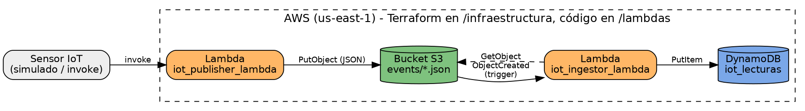
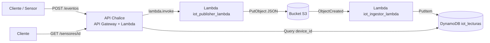
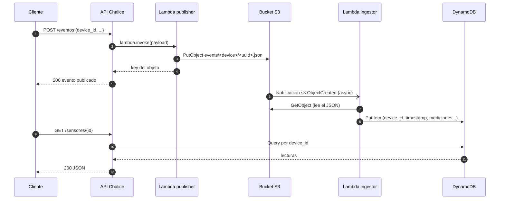

# Pipeline IoT: API → Lambda → S3 → Lambda → DynamoDB

Una API REST (Chalice) recibe la lectura de un sensor e invoca una lambda que la publica como JSON en S3; el bucket dispara otra lambda que la inserta en DynamoDB. La API también permite consultar las lecturas de un sensor.

## Arquitectura





## Flujo de un evento



## Estructura (simula tres repos independientes)

```
infraestructura/     # Terraform: bucket, tabla, lambdas publisher/ingestor, trigger
lambdas/             # Código de publisher e ingestor, tests, deploy.sh
api/                 # API REST con Chalice (NO usa Terraform; ver api/README.md)
Dockerfile           # Imagen de herramientas (AWS CLI, Terraform, Chalice, make, zip...)
GUIA-PASO-A-PASO.md  # Paso a paso desde el CMD de Windows (desplegar y probar en el Lab)
COMO-FUNCIONA.md     # Explicación detallada del código y de los servicios de AWS
Makefile             # Atajos
```

## Tipos de sensores

Las lambdas aceptan **cualquier tipo de sensor**. El id puede llamarse `device_id` o `sensor_id`, y el resto de campos se guarda tal cual:

```json
{"device_id": "sensor-01", "temperature": 23.5, "humidity": 60}
{"sensor_id": "ruido-01", "tipo": "ruido", "valor": 72.4}
```

`timestamp` es opcional (si no viene, se usa la hora actual en UTC). Si se invoca la publisher **solo con el id** (`make invoke`), genera una lectura simulada de temperatura y humedad.

---

# Cómo ejecutarlo

👉 **Sigue [GUIA-PASO-A-PASO.md](GUIA-PASO-A-PASO.md)**: explica todo desde el CMD de Windows (construir el contenedor, poner las keys del Learner Lab, desplegar, probar con evidencias y borrar).

📖 **Explicación detallada del código y de AWS: [COMO-FUNCIONA.md](COMO-FUNCIONA.md).**

En Windows no hace falta instalar `make`, AWS CLI, Terraform ni Chalice: todo corre dentro del contenedor `iot_dev_environment` (ver `Dockerfile`). Los comandos `make` se ejecutan **dentro** de ese contenedor.

## Referencia de comandos (dentro del contenedor)

| Comando | Qué hace |
|---|---|
| `make help` | Lista todos los comandos |
| `make test-all` | Pruebas locales de lambdas y API (moto, sin AWS) |
| `make infra-apply` / `make infra-destroy` | Crea / destruye la infraestructura (Terraform) |
| `make deploy` | Sube el código de las lambdas publisher e ingestor |
| `make invoke DEVICE=sensor-02` | Invoca la publisher directamente |
| `make scan` | Muestra la tabla `iot_lecturas` |
| `make api-deploy` / `make api-delete` | Despliega / elimina la API Chalice |
| `make api-url` / `make api-smoke` | URL de la API / prueba POST + GET |
