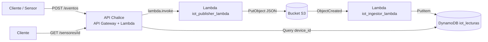
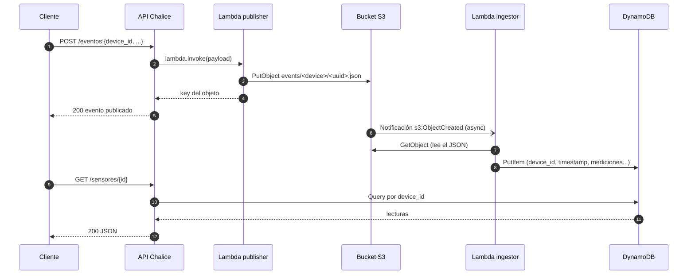

# Pipeline IoT: API → Lambda → S3 → Lambda → DynamoDB

Una API REST (Chalice) recibe la lectura de un sensor e invoca una lambda que la publica como JSON en S3; el bucket dispara otra lambda que la inserta en DynamoDB. La API también permite consultar las lecturas de un sensor.

## Arquitectura




## Flujo de un evento



## Estructura (simula tres repos independientes)

```
infraestructura/     # Terraform: bucket, tabla, lambdas publisher/ingestor, trigger
lambdas/             # Código de publisher e ingestor, tests, deploy.sh
api/                 # API REST con Chalice (NO usa Terraform; ver api/README.md)
Dockerfile           # Imagen de herramientas (AWS CLI, Terraform, Chalice, make, zip...)
docker-compose.yml   # Ejecuta los comandos del Makefile dentro de esa imagen
Makefile             # Atajos
```

## Tipos de sensores

Las lambdas aceptan **cualquier tipo de sensor**. El id puede llamarse `device_id` o `sensor_id`, y el resto de campos se guarda tal cual:

```json
{"device_id": "sensor-01", "temperature": 23.5, "humidity": 60}
{"sensor_id": "ruido-01", "tipo": "ruido", "valor": 72.4}
```

`timestamp` es opcional (si no viene, se usa la hora actual en UTC). Si se invoca la publisher **solo con el id** (`make invoke`), genera una lectura simulada de temperatura y humedad.

---

# Paso a paso: probar todo en AWS Learner Lab desde Windows

En Windows no hace falta instalar `make`, AWS CLI, Terraform ni Chalice: todo corre dentro de un contenedor Docker. **Solo necesitas Docker Desktop abierto.** Todos los comandos se escriben en **PowerShell**, desde la carpeta del proyecto.

> Si Docker es incómodo y usas Linux o Mac, los mismos comandos funcionan sin el prefijo `docker compose run --rm tools` (instalando AWS CLI, Terraform y `pip install -r api/requirements-dev.txt -r lambdas/requirements.txt`).

## 1. Construir la imagen de herramientas (solo la primera vez)

```powershell
cd "C:\Users\JoseB\Desktop\7_lambda_with_dynamodb_with terraform"
docker compose build
```

Para no repetir el prefijo largo, puedes crear un alias en la sesión de PowerShell:

```powershell
function tools { docker compose run --rm tools @args }
tools make help
```

(En el resto de la guía se escribe completo: `docker compose run --rm tools ...`.)

## 2. Pruebas locales (sin AWS)

```powershell
docker compose run --rm tools make test-all
```

Deben pasar las pruebas de las lambdas y de la API (usan `moto`, AWS simulado en memoria).

## 3. Credenciales del Learner Lab

1. En el Learner Lab pulsa **Start Lab** y espera a que el punto se ponga verde.
2. Pulsa **AWS Details** y, junto a **AWS CLI**, pulsa **Show**. Copia el bloque completo (`[default]`, `aws_access_key_id`, `aws_secret_access_key`, `aws_session_token`).
3. Pégalo en el archivo `C:\Users\<tu usuario>\.aws\credentials` (sin extensión):

   ```powershell
   New-Item -ItemType Directory -Force "$env:USERPROFILE\.aws" | Out-Null
   notepad "$env:USERPROFILE\.aws\credentials"
   ```

   Pega el bloque, guarda y cierra. Comprueba que Notepad no lo haya guardado como `credentials.txt`.
4. Verifica el acceso:

   ```powershell
   docker compose run --rm tools aws sts get-caller-identity
   ```

   Debe mostrar tu `Account` y un `Arn` con `voclabs`.

> Las credenciales **caducan** cuando termina la sesión del lab (unas 4 h). Si aparece `ExpiredToken`, repite este paso con las nuevas.

## 4. Crear la infraestructura (Terraform)

```powershell
docker compose run --rm tools make infra-apply
```

Crea el bucket `iot-eventos-<cuenta>`, la tabla `iot_lecturas`, las dos lambdas (con código vacío) y el trigger S3 → ingestor. El estado de Terraform queda en `infraestructura/` en tu disco.

## 5. Subir el código de las lambdas

```powershell
docker compose run --rm tools make deploy
```

## 6. Probar el flujo base (sin API)

```powershell
docker compose run --rm tools make invoke
docker compose run --rm tools make scan
```

`invoke` dispara la publisher con una lectura simulada de `sensor-01`. Unos segundos después, `scan` debe mostrar la fila en DynamoDB.

## 7. Desplegar la API (Chalice)

```powershell
docker compose run --rm tools make api-deploy
```

El script pone en `api/.chalice/config.json` el ARN de `LabRole` de tu cuenta y ejecuta `chalice deploy`. Al terminar muestra la URL, por ejemplo:

```
Rest API URL: https://abc123.execute-api.us-east-1.amazonaws.com/api/
```

Para verla de nuevo: `docker compose run --rm tools make api-url`.

## 8. Probar la API

**Prueba automática** (hace un POST, espera 5 s y hace el GET):

```powershell
docker compose run --rm tools make api-smoke
```

**Prueba manual desde PowerShell** (cambia la URL por la tuya):

```powershell
$URL = "https://abc123.execute-api.us-east-1.amazonaws.com/api"

# POST: sensor de temperatura
Invoke-RestMethod -Method Post -Uri "$URL/eventos" -ContentType "application/json" `
  -Body '{"device_id":"sensor-01","temperature":23.5,"humidity":60}'

# POST: otro tipo de sensor
Invoke-RestMethod -Method Post -Uri "$URL/eventos" -ContentType "application/json" `
  -Body '{"sensor_id":"ruido-01","tipo":"ruido","valor":72.4}'

# GET: lecturas de un sensor (las más recientes primero)
Invoke-RestMethod "$URL/sensores/sensor-01" | ConvertTo-Json -Depth 5
Invoke-RestMethod "$URL/sensores/ruido-01?limit=1" | ConvertTo-Json -Depth 5

# Error 400: body sin id de sensor
try { Invoke-RestMethod -Method Post -Uri "$URL/eventos" -ContentType "application/json" -Body '{"temperature":1}' }
catch { $_.Exception.Response.StatusCode; $_.ErrorDetails.Message }
```

**Prueba manual con `curl`** (abre una consola Linux dentro del contenedor):

```powershell
docker compose run --rm tools bash
```

```bash
URL=$(bash api/deploy.sh url)        # termina en "/"
curl -X POST ${URL}eventos -H 'Content-Type: application/json' \
  -d '{"device_id":"sensor-01","temperature":23.5,"humidity":60}'
curl ${URL}sensores/sensor-01
curl "${URL}sensores/sensor-01?limit=2"
curl -i -X POST ${URL}eventos -H 'Content-Type: application/json' -d 'no es json'   # 400
exit
```

> En PowerShell 5.1, `curl` es un alias de `Invoke-WebRequest` y las comillas del JSON se pierden al pasarlo a programas externos. Por eso se usa `Invoke-RestMethod` o la consola del contenedor.

## 9. Limpiar al terminar

```powershell
docker compose run --rm tools make api-delete      # borra la API (lambda + API Gateway de Chalice)
docker compose run --rm tools make infra-destroy   # borra bucket, tabla, lambdas y trigger (pide "yes")
```

Borra la API **antes** de la infraestructura.

## Problemas comunes

| Síntoma | Causa / solución |
|---|---|
| `ExpiredToken` / `InvalidClientTokenId` | Credenciales vencidas: repite el paso 3. |
| `Unable to locate credentials` | Falta `C:\Users\<usuario>\.aws\credentials` (o quedó como `.txt`). |
| `failed to connect to the docker API` | Docker Desktop no está abierto. |
| `make deploy`: "la función ... no existe" | Falta el paso 4 (`make infra-apply`). |
| `POST /eventos` devuelve 502 | La publisher no existe o falló: revisa los pasos 4 y 5 y los logs en CloudWatch (`/aws/lambda/iot_publisher_lambda`). |
| `GET` devuelve `cantidad: 0` justo después del POST | La ingestor es asíncrona: espera unos segundos y repite. |
| `infra-apply`: la tabla o las lambdas "already exist" | Quedaron de otra sesión sin estado de Terraform en este equipo: bórralas desde la consola de AWS (o con `make infra-destroy` en el equipo que las creó) y repite. |

## Referencia de comandos

```
docker compose run --rm tools make help
```

| Comando | Qué hace |
|---|---|
| `make test-all` | Pruebas locales de lambdas y API |
| `make infra-apply` / `make infra-destroy` | Crea / destruye la infraestructura (Terraform) |
| `make deploy` | Sube el código de las lambdas |
| `make invoke DEVICE=sensor-02` | Invoca la publisher directamente |
| `make scan` | Muestra la tabla `iot_lecturas` |
| `make api-deploy` / `make api-delete` | Despliega / elimina la API Chalice |
| `make api-url` / `make api-smoke` | URL de la API / prueba POST + GET |
